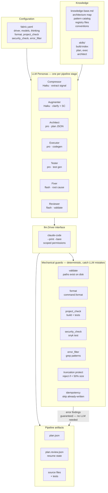
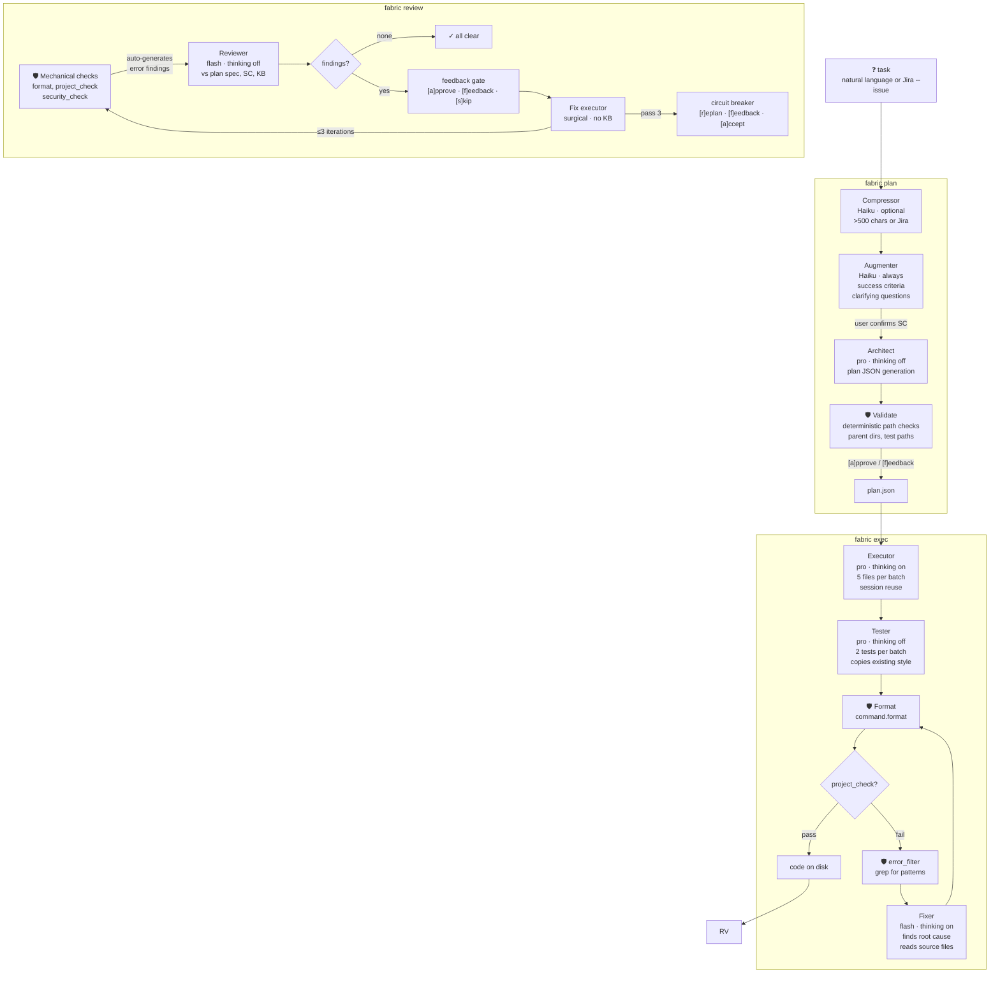
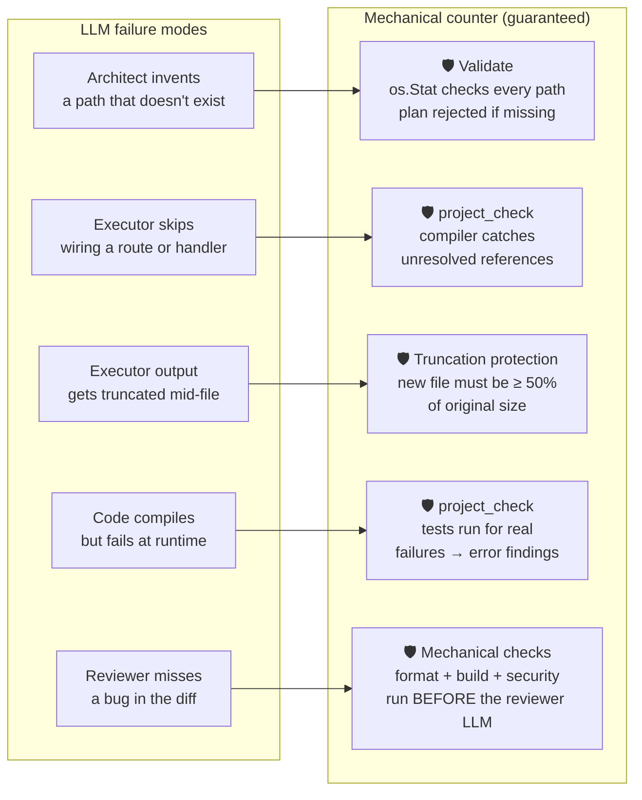

# Fabric

AI-driven planning, execution, and review tool for software changes. `plan` generates
implementation plans from natural language tasks, resolving ambiguity interactively.
`exec` writes the code and generates tests. `test` runs only the test phase from a
plan. `review` validates and self-corrects through a reviewer fix loop.

## User Guide

### Install

```bash
bash install.sh
fabric version
```

Requires Go. For LLM calls: `claude` CLI.

### Quick start

```bash
fabric init                           # bootstrap fabric.yaml + build knowledge base
fabric init --refresh                 # rebuild fabric.yaml + knowledge-base.md

# Full pipeline: plan → exec → review
fabric plan "add a deactivation endpoint" -y --out plan.json
fabric exec plan.json | fabric review

# Step by step with previews
fabric plan "add a health check" -y --out plan.json   # generate the plan
fabric exec plan.json --dry-run                         # preview files before writing
fabric exec plan.json                                   # write for real
fabric review plan.json --dry-run                       # preview review findings
fabric review plan.json                                 # review + fix loop
```

Run `fabric help` for the full command reference, or `fabric help <command>` for details on a specific command.

### Linear as the work source

Pull work from Linear instead of typing a task. Set `LINEAR_API_KEY` (a personal
API key from [Security & access settings](https://linear.app/settings/account/security)),
then:

```bash
fabric linear list --team FAB          # open issues, marked ready vs blocked
fabric linear show FAB-12              # print an issue as task text
fabric plan --linear FAB-12 --out plan.json   # plan straight from an issue
```

An issue is **ready** when it is not done/canceled and has no unfinished blocker
(a `blockedBy` relation). This is the query that answers "what is parallel-safe to
pick up right now?" — the seam a Linear-driven orchestrator builds on. `list`
pages through every open issue, so foundation items are never missed.

### Configuration — `fabric.yaml`

```yaml
project:
  name: my-project

llm:
  driver: claude-code
  model: claude-opus-4-8                # default for all phases

  # Global inject: rules/skills applied to EVERY phase prompt.
  # Per-phase inject in phases.<name>.inject is appended (not replaced).
  # When injected constraints conflict with KB patterns, injected constraints
  # take absolute precedence. Rules and skills override KB.
  inject:                                      # optional — global defaults
    - rules/security
    - skills/observability

  # Global kb_sections: KB section numbers every phase uses by default.
  # Per-phase kb_sections in phases.<name>.kb_sections replaces (not merges).
  # Empty / omitted = use the full KB. Set to [] to suppress KB entirely.
  kb_sections: ["1","2","3","7"]               # optional — global default

  # Per-phase overrides (all fields optional). Phases not listed here
  # inherit the global model, timeout, inject, and kb_sections above.
  phases:
    # ── plan pipeline ──────────────────────────────────────────────
    compress:                                   # task signal extraction
      model: claude-haiku-4-5-20251001          # cheap/fast model
      timeout_seconds: 120

    augment:                                    # clarifying questions + SC
      model: claude-haiku-4-5-20251001
      timeout_seconds: 120

    architect:                                  # implementation plan generation
      model: claude-opus-4-8             # reasoning model
      thinking: disabled                        # enabled | adaptive | disabled
      timeout_seconds: 600
      inject:                                   # appended to global inject
        - rules/domain-driven-design
      kb_sections: ["1","2","4","6"]            # overrides global kb_sections

    # ── exec pipeline ─────────────────────────────────────────────
    exec_create:                                # code + file generation
      model: claude-opus-4-8
      thinking: enabled                         # enabled | adaptive | disabled
      timeout_seconds: 900                      # large plans need more time

    test:                                       # test generation
      model: claude-opus-4-8
      thinking: disabled                        # enabled | adaptive | disabled
      timeout_seconds: 300

    # ── fix ────────────────────────────────────────────────
    fix:                                        # build error resolution
      model: claude-sonnet-4-6
      thinking: enabled                         # enabled | adaptive | disabled
      timeout_seconds: 600

    # ── review pipeline ───────────────────────────────────────────
    review:                                     # semantic validation
      model: claude-sonnet-4-6
      thinking: disabled                        # enabled | adaptive | disabled
      timeout_seconds: 600

  timeout_seconds: 600                           # global fallback (default: 600)

command:
  format: ./gradlew ktlintFormat                 # or gofmt, prettier, etc.
  project_check: ./gradlew check                 # build + tests
  error_filter:                                  # grep patterns to extract failures (list)
    - ") FAIL"
    - Exception
  security_check: snyk test
  skip_project_check: false                      # set true to skip in fabric.yaml
  skip_security_check: false
  test_troubleshooting:                          # shell commands before checks
    - colima start
  review_feedback_timeout_seconds: 30            # reviewer gate timeout (default: 30)
```

| Section | What it controls |
|---|---|
| `project.name` | Project identity |
| `llm.driver` | `claude-code` |
| `llm.model` | Default model (all phases) |
| `llm.inject` | Global rules/skills injected into every phase prompt (e.g. `["rules/security", "skills/observability"]`) |
| `llm.kb_sections` | Global KB section filter (empty = full KB). Per-phase `kb_sections` overrides this. |
| `llm.phases.<phase>.model` | Per-phase model override |
| `llm.phases.<phase>.thinking` | Extended thinking mode: `enabled`, `adaptive`, `disabled` (claude-code only) |
| `llm.phases.<phase>.timeout_seconds` | Per-phase LLM timeout (overrides global) |
| `llm.phases.<phase>.session_reuse` | Reuse LLM session across feedback iterations and batches |
| `llm.phases.<phase>.inject` | Per-phase rules/skills — appended to global `llm.inject`. Resolved from `.claude/<path>/RULE.md` or `SKILL.md` |
| `llm.phases.<phase>.kb_sections` | Per-phase KB section filter — replaces global `llm.kb_sections`. Set to `[]` for no KB |
| `llm.timeout_seconds` | Global LLM call timeout (default: 600) |
| `command.format` | Executor post-write formatting |
| `command.project_check` | Reviewer build/test command |
| `command.error_filter` | Grep patterns (list) to filter check output for the reviewer/build-fix LLM |
| `command.security_check` | Security scan command (default: `snyk test`) |
| `command.skip_project_check` | Skip build/test in review |
| `command.skip_security_check` | Skip security scan in review |
| `command.test_troubleshooting` | Pre-review setup commands (colima/Docker etc.) |
| `command.review_feedback_timeout_seconds` | Reviewer gate timeout (default: 30) |

### Inject precedence

When injected rules/skills conflict with `knowledge-base.md` patterns, **injected constraints take absolute precedence**. Skills and rules override KB exemplars. This rule is embedded in every persona prompt (Architect Rule 0). It serves two workflows:

- **Mature repos:** KB encodes established conventions. Injected rules add project-specific overrides (security, observability, compliance).
- **Greenfield projects:** No KB exists yet. Injected skills define the conventions entirely — where files go, which patterns to follow, naming conventions. Add rules/skills to `.claude/`, set `kb_sections: []` per phase, and the pipeline runs on injected constraints alone.


## Architecture

Design decisions that shaped fabric are documented as ADRs in [`docs/adr/`](docs/adr/). Key decisions include persona prompt architecture ([ADR 001](docs/adr/001-persona-prompt-architecture.md)), context isolation ([ADR 002](docs/adr/002-context-isolation.md)), scoped permissions ([ADR 003](docs/adr/003-scoped-permissions.md)), batched execution ([ADR 004](docs/adr/004-batched-execution.md)), session reuse ([ADR 005](docs/adr/005-session-reuse.md)), fix concurrency gating ([ADR 006](docs/adr/006-fix-concurrency-gate.md)), and build-fix simplification ([ADR 010](docs/adr/010-buildfix-simplification.md)).

### System overview

How configuration, knowledge, personas, and drivers connect at runtime.



### Pipeline flow

How a task moves through fabric, end to end. Stages marked 🛡️ are mechanical — no LLM, never misses.



### Why mechanical guards matter

Every mechanical guard counters a specific LLM failure mode. The LLM is probabilistic — it can
hallucinate paths, skip registries, or truncate output. The mechanical layer is deterministic —
real filesystem checks, real compilers, real formatters. None of it depends on the LLM noticing
its own mistakes.



The reviewer LLM never sees raw build output — `error_filter` extracts only the relevant lines,
and mechanical failures are injected as structured findings. A broken build always surfaces. A
truncated file never overwrites working code. Format violations are fixed before semantic review.
The LLM handles architecture and conventions; the shell handles correctness.

### Design philosophy

**Persona pipeline, not agent loop.** Fabric rejects the "you have tools, figure it out" model. Instead
it runs a fixed pipeline of 7 personas, each with a Process section (workflow) and a Rules section
(hard constraints). Process without Rules produces contradictory output; Rules without Process
lacks self-verification. The architect *only* produces plans. The executor *only* writes files.
The reviewer *only* validates. Each phase has a structured output contract — JSON plan,
`=== FILE: path ===` blocks, review findings JSON — so phases compose deterministically via pipes.

**Human gates at plan-level, not code-level.** Other tools ask you to approve file-by-file diffs.
Fabric asks you to approve *what to build and where*. The plan says "add a controller at X, modify
the service at Y, register the route at Z" — you say yes/no to the architecture. The executor then
writes the actual code without interruption. This is the right abstraction for convention-heavy
codebases: you care about structure, not syntax. The plan is a compass — the architect says
*what* and *where*; the executor decides *how*.

**The LLM handles semantics; the shell handles correctness.** LLMs hallucinate paths, skip
registries, and truncate output. Fabric doesn't ask the LLM to notice its own mistakes — it runs
mechanical checks deterministically *before* the reviewer sees the code. Every path is verified with
`os.Stat`. Every file written must be at least 50% the size of the original (truncation protection).
Every build runs the real compiler. Failures auto-generate structured findings that the reviewer
receives as input, not raw output. The LLM is never the last line of defense.

**Batching prevents silent truncation.** LLMs have finite output token limits. A 20-file plan
produced in a single call would silently drop the last files. Splitting into batches of 5 (2 for
tests) keeps every file within the output window. Each batch sees the full plan context for
cross-file coordination but only outputs its assigned files. Session reuse then amortizes the cost —
the static context (persona + KB) is uploaded once on the bootstrap call; subsequent batches
resume with only their batch-specific prompt. The architecture decision is documented in
[ADR 004](docs/adr/004-batched-execution.md) and [ADR 005](docs/adr/005-session-reuse.md).

**The LLM understands errors better than heuristic code.** Fabric's build-fix loop once had 15+
language-specific error classifiers, path resolvers, and file indexers. It missed test failures,
couldn't resolve bare filenames, and often returned empty — the LLM never saw the errors.
The current design replaces all of that with `grep`-style filtering: user-supplied `error_filter`
patterns extract matching lines with ±5 context lines, and the entire filtered output goes to
the fixer LLM in a single call. The model finds root causes, identifies which files to modify,
and reads source files itself. This removed 333 lines of heuristic code and resolved 50
failing integration tests in 2 fix passes
([ADR 010](docs/adr/010-buildfix-simplification.md)).

**Context isolation by design.** Without isolation, project rules (`.claude/CLAUDE.md`, `rules/`,
`skills/`) leak into every LLM call — a 15× input token multiplier on exec phases. Fabric
uses `--bare` mode to block `.claude/` loading and builds a scoped `settings.json` with
permissions locked to the project root. Architect input tokens dropped from 369K to 135K
([ADR 002](docs/adr/002-context-isolation.md), [ADR 003](docs/adr/003-scoped-permissions.md)).

**Fabric is not a general-purpose coding agent.** It is built for teams doing structured,
convention-heavy development — DDD, hexagonal architecture, CQRS — where the shape of a correct
implementation is well-understood. It doesn't explore the codebase to discover the right design; it
generates against a known set of patterns and conventions encoded in `knowledge-base.md`. If the KB
is wrong or missing, the plan is wrong. This is a weakness for greenfield projects and a strength
for monorepos with hundreds of similar services.

> **Fabric is to convention-heavy development what an assembly line is to manufacturing.** If you're
> building custom furniture, you want a craftsman (Claude Code). If you're producing 100 identical
> chairs from a known blueprint, you want the assembly line. The blueprint is the KB + exemplars.
> The quality inspector is the reviewer + mechanical checks. The line workers are the personas.
>
> Fabric doesn't compete with Claude Code or Cursor — it competes with *having developers write
> boilerplate by hand* in repos where the right answer is already known.
